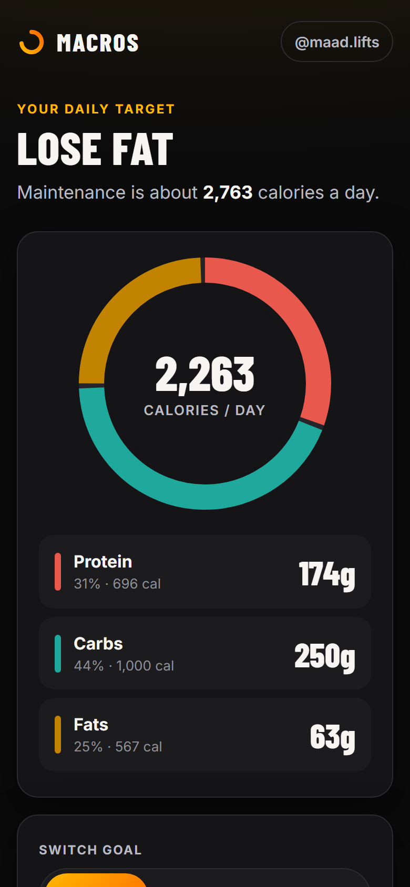
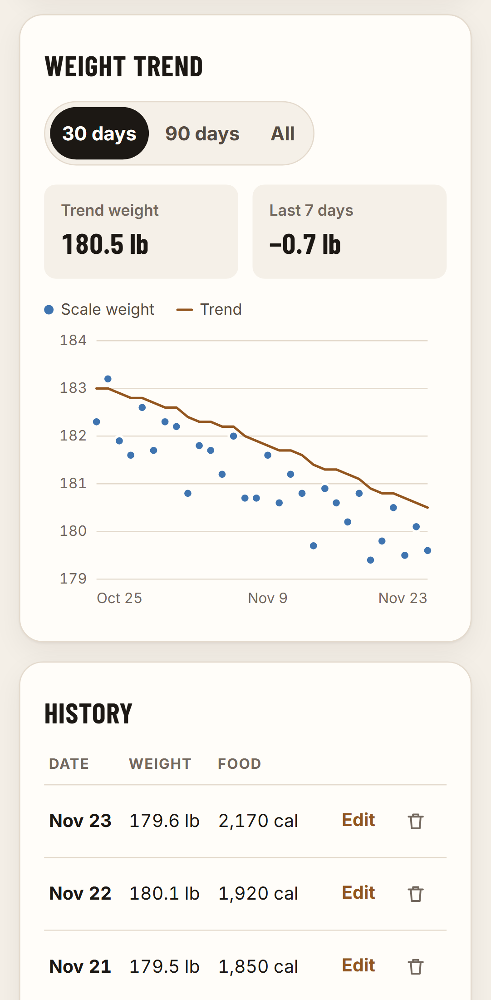
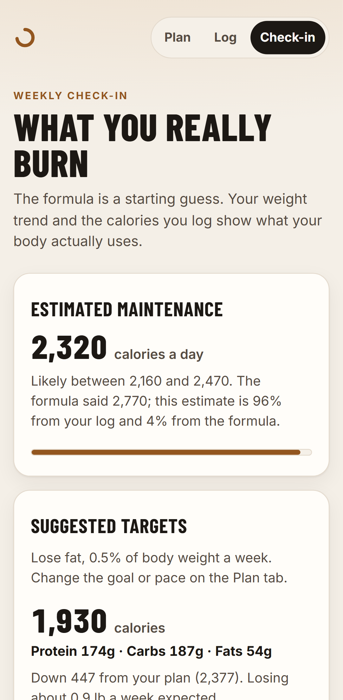
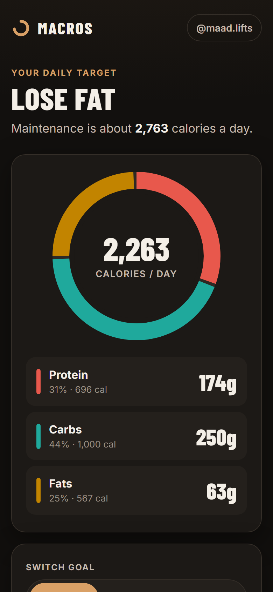

# Macro Calculator

Daily calories and protein, carb and fat targets in four short steps: about you, your body, how
active you are, and your goal (lose fat, maintain or build muscle).

**Live:** https://samaadturner.github.io/macro-calculator/

<p>
  
  
  
  
  
</p>

No sign-up and no server. Answers, saved plans and the log stay in the browser's local storage,
so a returning visitor lands straight on their results. It installs to a phone's home screen
and works offline.

## What it does

- Four steps, one group of questions per screen, with messages next to the field that needs fixing.
- Pounds and feet or kilograms and centimetres. Switching converts both weight and height, and
  switching back and forth never changes the numbers.
- Results: a ring of calories by macro, grams and share for each macro, a goal switcher that
  updates the numbers right away, grams per meal for 3 to 6 meals, and the working behind the
  numbers.
- Save up to ten plans on the device, copy a plan as text, or share it from a phone.
- Install it from the browser (Add to Home Screen, or the install button in Chrome and Edge). After
  the first visit a service worker keeps a copy of every file, so the app opens and saves with
  no connection. When a new version is out, a banner offers Reload; it never reloads by itself,
  so a half-typed log entry is not lost.
- A daily log (the Log tab): weight, calories eaten and optional protein, carbs and fats for
  each day, with a tick for "not all of this day's food is logged". A chart shows each weigh-in and a smoothed trend (an exponential moving average
  that moves 10% toward each new weigh-in, from John Walker's *The Hacker's Diet*), the trend
  weight, and how much it moved over the last 7 days. The chart has a hover readout and can be
  read with the arrow keys; the history table below it lists every number.
- Add from a food: search [Open Food Facts](https://world.openfoodfacts.org) by name or barcode
  (typed, or scanned with the camera in any browser), pick the amount in grams (one serving is filled in when the package gives
  its weight), and its calories and macros are added to the day being typed. Several foods add
  up; the day is still saved as a daily total. Searches go to their search service
  (search.openfoodfacts.org), which returns names and brands; picking one loads that
  product's numbers. Only the search words, the picked product's code or the barcode are
  sent; nothing from the log leaves the device. Searches run when you press Search, never while
  typing, and the app stays under Open Food Facts' limits (8 searches and 12 barcode lookups a
  minute, against their 10 and 15). Typed barcodes are checked with their check digit before a
  lookup is spent. Food data is under the Open Database License.
- A scan button on every tab (bottom right) opens the camera straight away. After the amount,
  the food goes into today's log; on the Log tab it fills the form instead, like the panel
  there. Browsers with a built-in barcode reader (Chrome on Android) use it; the others
  (Safari, Firefox, Chrome on Windows) load a bundled one, [zxing-wasm](https://github.com/Sec-ant/zxing-wasm)
  through [barcode-detector](https://github.com/Sec-ant/barcode-detector), the first time the
  camera opens. Its 950 KB WebAssembly file is served from this site, not a CDN, and is not part
  of the offline copy (a lookup needs the internet anyway).
- A weekly check-in (the Check-in tab) that estimates what you really burn from your log and
  suggests new targets. See below.
- Export the log as a JSON backup and import it on another device. Days in the backup replace
  the same days on the device; anything unreadable is skipped and counted.
- Import daily totals from another app's CSV export (Cronometer's daily nutrition or biometrics
  export, MyFitnessPal's nutrition or measurement summary, or a spreadsheet). The columns are
  guessed from common header names (Date or Day; Energy (kcal) or Calories; Protein, Carbs or
  Carbohydrates, Fat; Weight) and shown as dropdowns to check or change before anything is
  saved, with a preview of the days. Rows on the same day are added up (one row per meal
  becomes the day's total), a file with one measurement per row (Day, Metric, Unit, Amount)
  is read for body weight only in each row's unit, and a Completed column set to false
  imports the day as not complete. Imported food replaces that day's food and keeps its
  weigh-in, and the other way round.
- Habits that do not punish a missed day: no streaks, badges or daily nags. An optional weekly
  check-in reminder is a calendar file you add to your own calendar (the app cannot send
  notifications without a server). During a fat loss phase the check-in offers a 1 or 2 week
  maintenance break, and after 12 weeks of fat loss in a row it suggests one; the fat loss
  targets come back by themselves when the break ends. Every tab ends with a short line for
  anyone stressed about food or weight, with ANAD's free US helpline and 988.
- Light and dark themes in warm gym colours (cream walls, wood, black iron), following the
  phone's setting.

## How the numbers are worked out

1. **Resting energy (BMR)** with the Mifflin-St Jeor equation:
   `10 × kg + 6.25 × cm − 5 × age`, then `+5` for men and `−161` for women.
   "Other" uses the average of the two (`−78`). It is the best-tested equation for adults,
   and still more than 10% off for about one person in four
   ([Frankenfield 2013](https://pubmed.ncbi.nlm.nih.gov/23631843/)).
2. **Maintenance** = BMR × activity factor (1.2 mostly sitting to 1.9 athlete). The activity
   choices name both the job and the training, because people who sit at work and lift tend to
   pick too high.
3. **Goal pace,** as a share of body weight per week:
   - Lose fat: 0.25%, 0.5% (default), 0.75% or 1%. Losing 0.5 to 1% a week helps keep muscle
     ([Helms et al. 2014](https://pmc.ncbi.nlm.nih.gov/articles/PMC4033492)).
   - Build muscle: 0.15%, 0.25% (default) or 0.5%. Newer lifters can gain faster; experienced
     ones should go slower ([Iraki et al. 2019](https://pmc.ncbi.nlm.nih.gov/articles/PMC6680710)).
   - The pace becomes calories with the energy in a kg of weight change for your body (see
     step 3 of the check-in below; about 6,620 calories per kg for a 180 lb, 5 ft 10 in man),
     not the flat 7,700 rule: leaner people lose more lean tissue per kg, so each kg holds fewer
     calories ([Hall 2008](https://pmc.ncbi.nlm.nih.gov/articles/PMC2376744)). The first weeks
     of a diet lose more water, so the scale moves faster at first.
   - The deficit is capped at 25% of maintenance and the surplus at 20%, and the results say
     when a cap applies. The results show the expected change in lb or kg per week.
4. **Calorie floor, fat loss only:** not below 1,200 (women), 1,500 (men) or 1,350 (other). This
   is a common rule of thumb, not a formal guideline. It never pushes a target above
   maintenance: if maintenance is already below the floor, the fat loss target is maintenance
   and the results suggest planning any loss with a doctor or dietitian. When the floor applies,
   the results say so.
5. **Protein:** 2.2 g per kg when losing fat, 1.8 g per kg otherwise. Muscle gains level off at
   around 1.6 g/kg ([Morton et al. 2018](https://pubmed.ncbi.nlm.nih.gov/28698222/)), and more
   helps keep muscle during a cut ([ISSN 2017](https://pubmed.ncbi.nlm.nih.gov/28642676/)). Above
   a BMI of 25 the weight used is the weight at BMI 25 for that height, because total weight
   overstates muscle at higher body fat. Capped at 40% of calories.
6. **Fat:** 25% of calories, inside the 20 to 35% of the US Dietary Guidelines. **Carbs:** the
   rest, always at least about 35%.

Fat loss plans are not offered under 18, and under 18 the results note that the formula was
built from adults. These are estimates: real energy needs can be a few hundred calories away
from any formula, which is why the results suggest checking your weight trend after 2 to 3
weeks.

The math was checked against a separate version written from the papers on 9,000 combinations
of sex, age, weight, height, activity, goal and pace (calories, every macro and the weekly
change all match); the unit tests keep worked examples from that check and run the same 9,000
combinations on every push.

## The weekly check-in

The formula above is a starting guess, and for about one person in four it is off by more than
10%. After about two weeks of logging, the check-in works out your real maintenance from the log:

1. **Weight change:** a least-squares line through the weigh-ins of the last 35 days. Missed
   weigh-ins need no filling in; the line spans them.
2. **Calories eaten:** the average of the days with calories logged between the first and the
   last weigh-in (food on the day of the last weigh-in shows up on the scale the next day, so it
   is left out). Days with no calories are skipped, not counted as zero. It uses what you ate,
   not the plan, so eating off plan does not throw it off. Someone who always forgets the
   cooking oil gets an estimate in their own logged calories, which is what they compare
   against anyway.
3. **Energy in a kg of weight change:** not a fixed 7,700. A kg of fat holds about 9,440
   calories and a kg of lean tissue about 1,820 ([Hall 2008](https://pmc.ncbi.nlm.nih.gov/articles/PMC2376744)).
   The share of a change that is fat follows Forbes' curve, fat mass / (fat mass + 10.4 kg),
   with body fat estimated from BMI, age and sex
   ([Deurenberg 1991](https://pubmed.ncbi.nlm.nih.gov/2043597/)). For a 180 lb, 5 ft 10 in,
   30 year old man that is about 6,620 calories per kg; leaner people get less, heavier people more.
4. **Burn from the log** = average calories eaten − weight change per day × energy per kg. A
   logged day under half the usual (median) day looks like a forgotten meal and is left out of
   the average, since what was eaten still shows on the scale. If more than 1 in 5 days are that
   low it looks like a pattern (fasting days, say), and they all stay in. Days ticked as not
   complete in the log are left out too, however close to usual they are. The page lists any
   day it left out.
5. **Mixed with the formula** by how certain each one is (inverse-variance weighting): the
   formula is taken as ±15%, the log's uncertainty comes from the scatter of the weigh-ins
   around the line (at least 0.4 kg a day) and of the logged calories. Scale water carries over
   from one day to the next, so the weigh-ins are not independent; the line's uncertainty is
   multiplied by 1.73, the usual correction for a day-to-day carry-over of about 0.5. The log's
   uncertainty is also divided by the share of days with calories logged, because the days left
   off a log are often the bigger ones (a weekend away), so a patchy log tends to read low. A
   short, noisy or patchy log leans on the formula; with four weeks of daily data the log does
   most of the work. The page shows the split and a likely range.
6. **Weekly limit:** between saved check-ins the estimate moves at most 200 calories a week, so
   one odd week does not swing the targets.

The suggested targets then use the same rules as the plan (pace, caps, the floor, the macro
split), with the measured maintenance and the energy per kg above. The first estimate needs 5
weigh-ins spread over at least 10 days and 7 days with calories. The page says when the log is
far (35%) from the formula and suggests checking the logging, and when fewer than 70% of days
have calories it says the estimate leans more on the formula. Check-ins are saved on the device
with a history, and the Plan tab shows the latest one above the formula numbers.

**Maintenance breaks.** Studies of diet breaks disagree on fat loss: two weeks on, two weeks
off did better in [MATADOR (Byrne 2018)](https://pubmed.ncbi.nlm.nih.gov/28925405/), and one
week off every three gave the same fat loss with less appetite in
[ICECAP (Peos 2021)](https://pubmed.ncbi.nlm.nih.gov/33587549/). So a break is offered on the Check-in tab and
suggested after 12 weeks of fat loss check-ins in a row (a check-in with another goal, a
finished break, or more than four weeks without a check-in starts the count again), never
pushed. During one the suggested targets are maintenance and check-ins save as maintain; the
plan's goal is not changed. The targets never go under the fat loss floor, break or not,
unless maintenance itself is lower.

## How accurate the check-in is (simulation study)

There is no public dataset of daily weights and logged calories with a measured true
expenditure, so the check-in was tested on simulated people whose true expenditure is known
([`sim/`](sim), run with `npm run simulate`, full tables in [`sim/RESULTS.md`](sim/RESULTS.md)).

**The model.** 2,000 adults (18 to 65, BMI 19 to 36, a mix of activity levels and goals) each
log for six weeks while eating their formula plan. Their bodies follow a simple version of
Hall's energy balance model: fat and lean change by Forbes' curve, and expenditure follows body
size, the thermic effect of food (10% of a change in intake) and adaptive thermogenesis (14%,
settling over 14 days) from [Hall et al. 2011](https://pubmed.ncbi.nlm.nih.gov/21872751/). Each
person's real expenditure is off from the formula (resting energy ±8.5%, which fits Mifflin
being within 10% for about 75% of people; activity ±10%, an assumption), and their body fat is
off from Deurenberg's estimate by its published 4.1 points. On top of that, the things that
make a real log messy:

- a glycogen and water drop of up to 1.5 kg in the first days of a diet (an assumption sized to
  the drop people see),
- scale noise of 0.3 to 0.8% of body weight that carries over between days, a small weekend
  bump, and a menstrual cycle swing of 0.3 to 1 kg for women under 50,
- eating 10 to 25% more or less than planned on any day, and leaving 0 to 30% of food out of
  the log (self-reports usually run low:
  [Hill and Davies 2001](https://pubmed.ncbi.nlm.nih.gov/11348556/)),
- missing up to 40% of weigh-ins and up to 30% of food logs.

**The truth** at each weekly check-in is what the person really burned over the last 7 days,
counted in the calories they log (someone who logs 80% of what they eat needs targets in those
logged calories). The settings were tuned on a different random seed
([`sim/TUNING.md`](sim/TUNING.md)) from the one reported here.

Median error in calories a day, and the share of people within 10% of the truth:

| | Week 1 | Week 2 | Week 3 | Week 4 | Week 6 |
|---|---|---|---|---|---|
| Formula | 341 (28%) | 333 (29%) | 334 (29%) | 334 (29%) | 326 (29%) |
| Check-in | 341 (28%) | 188 (50%) | 143 (63%) | **119 (72%)** | **72 (89%)** |
| Formula, if everyone logged everything | 174 (61%) | 167 (63%) | 164 (63%) | 164 (64%) | 161 (64%) |
| Check-in, if everyone logged everything | 174 (61%) | 148 (68%) | 126 (74%) | 104 (85%) | 60 (96%) |

Week 1 has too little data, so the check-in shows the formula. What else the study found:

- **The energy per kg matters.** With a flat 7,700 calories per kg the week 4 error is 134
  instead of 119, so the app uses the body-based value for both the check-in and the plan.
- **The carry-over correction and the 35-day window help.** The first version (28 days, no
  correction) had a week 4 error of 130 and a week 6 error of 89.
- **The log alone is not enough early on.** Without the formula mix the week 2 error is 376,
  worse than the formula, mostly because of the early water drop.
- **It follows real change.** When everyone's burn rises 12% on day 21, the error jumps to 157
  at week 4 and is back to 86 by week 6.
- **Messy logs.** A second run gives half the people a 3 to 7 day holiday (eating 20 to 50%
  more, few weigh-ins, little logged), most of them one or two 3 to 7 day gaps with no log while
  eating up to 20% more, and a forgotten meal on up to 15% of normal days (all assumptions).
  Before the fixes above (leaving out forgotten-meal days, trusting patchy logs less) the
  estimate read about 90 calories low, because weight gained on days that were not logged, or
  logged in part, was put down to the days that were. With them:

  | Messy logs | Week 4 | Week 6 | Week 6, 90th percentile | Average error, week 4 |
  |---|---|---|---|---|
  | Without the fixes | 142 | 132 | 352 | −92 |
  | **The app** | **122** | **105** | **294** | **−39** |

  On clean logs the fixes cost 6 calories at week 2 and nothing later (week 4: 119 either way).
  Both were picked on the tuning seed ([`sim/TUNING-FIXES-MESSY.md`](sim/TUNING-FIXES-MESSY.md),
  [`sim/TUNING-FIXES.md`](sim/TUNING-FIXES.md)), with the cut-off at half rather than 60% of
  the usual day because it does almost as well and is safer for people who eat light on purpose.
  Messy logs are still the hardest case: 105 at week 6 against 72 on clean logs.
- **Ticking short days helps; guessing missed days does not.** Run on the same messy people and
  days, with only the habit changed:

  | Messy logs | Week 4 | Week 6 | Week 6, 90th percentile | Average error, week 4 |
  |---|---|---|---|---|
  | Nobody ticks or guesses | 122 | 105 | 294 | −39 |
  | Half the part-logged days ticked "not complete" | 121 | **99** | **270** | **−22** |
  | Half the missed holiday and gap days filled with a rough guess | 124 | 105 | 293 | −47 |

  A guess was modelled at 85% of what was eaten, give or take 15%, since people tend to guess
  big days low (an assumption). With accurate guesses the week 6 error would drop to 92, but
  low guesses only add low days, so the app offers the tick and does not ask for guesses.
- **Splitting the log at gaps made it worse.** Fitting the weight line separately on each side of
  a gap of 2 to 5 unlogged days, so weight gained during a holiday is not counted, raised the
  error on clean and messy logs alike. After a holiday the extra water comes off fast, and a
  fresh line through those days reads it as fat loss (the estimate turned too high). The app
  does not do it.
- **The weekly limit earns its place on messy logs.** Compared with no limit, the 200 a week
  limit cuts the error on messy logs (week 4: 122 vs 127, 90th percentile 320 vs 333) and the
  check-ins that jump over 200 calories more than the truth did (13% vs 17%), and costs 1 calorie
  at week 4 on clean logs. A tighter 100 limit is a little better on messy logs by week 6 (100
  vs 105) but worse on clean ones (81 vs 72), and a real 300 calorie rise would take three weeks to show, so the app
  keeps 200. On the separate seed, limits of 150 and 200 tie on messy logs and both beat 100 and
  no limit ([`sim/TUNING-MESSY.md`](sim/TUNING-MESSY.md)).
- **It is not a measure of your metabolism.** Counted in real calories, an under-logger's
  estimate is low by about the share they leave out. That is intended: their targets are
  compared with their logged calories.

These are simulated people: the results depend on the model's assumptions, which are listed
above and in [`sim/study.ts`](sim/study.ts). No real-user results are claimed.

## Built with

React 18 and TypeScript on Vite. No UI or chart library: the ring is a small SVG component and
the styles are one CSS file of design tokens (colours, type, spacing) in
[`src/styles.css`](src/styles.css), with a light set and a dark set. The macro colours were
checked for colour-blind separation and contrast against both card colours. Fonts (Inter and Barlow Condensed) are bundled, not loaded
from Google. The offline copy and the app manifest come from
[vite-plugin-pwa](https://vite-pwa-org.netlify.app/) (Workbox), which lists every built file by
its hashed name; the icons are drawn from the favicon by
[`scripts/make-icons.mjs`](scripts/make-icons.mjs).

```
src/
  engine/       the math, no React: checks, unit conversion, energy per kg, the plan
  form.ts       form state, unit switching, which step is complete
  storage.ts    local storage, guarded against blocked or broken data
  log/          the daily log: dates, entries, form checks, trend, backup files, CSV import
  food/         Open Food Facts lookups and the barcode reader
  coach/        the weekly check-in: the expenditure estimate and saved check-ins
  components/   the steps, the results page, the ring, the log and check-in pages and the weight chart
sim/            the simulation study: body model, simulated people, settings search
e2e/            Playwright tests, including axe accessibility scans
```

## Tests

- **183 unit tests** (Vitest) for the math (worked examples and 9,000 generated plans), the checks, unit switching, storage, the new-version banner, CSV import (quoting, meal rows, a Completed column, per-measurement weights, date orders, merging), the log
  (dates across month ends and daylight saving, the trend after gaps, backup files), the chart, and the check-in (hand-worked
  energy per kg and expenditure examples, scale noise, missed weigh-ins and calories, the 35-day window, the weekly limit, forgotten-meal days, ticked days, fasting
  days, patchy logs, splitting at gaps), maintenance breaks (saving, when one is running, counting weeks of fat loss), the reminder calendar file, food lookups (reading search results and products, kJ-only products, scaling to grams, barcode check digits, the
  per-minute limit, errors, adding foods to the day without rounding drift, saving a scanned food into a day and refusing amounts over the limits), and the
  simulation (seeded random numbers, energy balance, the water drop, holidays, gaps and forgotten meals, ticks and rough guesses, repeatable results). Every bug
  fixed in the old single-file version has a test, and one test runs 360 combinations of sex,
  goal, activity and extreme bodies to check no macro goes negative and the shares add to 100.
- **80 end-to-end tests** (Playwright) on a desktop and a touch phone screen (158 runs; one
  test is mouse-only and one is touch-only), against the production build. They cover the full flow in both unit systems, every error message, unit
  switching, the goal pace, the calorie floor (and that it never goes above maintenance), the under-18 rule, pill rows on a 320 px phone, saved plans, returning visitors, broken saved
  data, keyboard use, mouse hover versus touch on the ring, no sideways scrolling, logging,
  editing and deleting days, the not-complete tick, backup export and import, CSV import (meal rows into daily totals, a per-measurement weight file, a
  bad file, cancel), the app manifest and icons, working out a plan and saving a log day with the network off, the chart with the keyboard, the check-in (exact numbers checked
  against a separate Python version, saving, the weekly limit, a forgotten-meal day, a ticked day, a patchy log, the link from the Plan tab, three tabs on a 320 px phone), maintenance breaks (taking, saving, reloading, ending, the
  12-week suggestion, a finished break), the reminder download, the support line on every tab, food search and barcode lookup against a fake Open Food Facts
  (two foods adding up, Enter searching instead of saving, a product with no calories, a bad
  check digit, a missing product,
  a busy or unreachable service, a camera scan), the scan button on every tab (saving into
  today from the Plan tab, filling the form on the Log tab, no camera, a refused camera,
  closing mid-scan stops the camera, and the bundled reader decoding a real EAN-13 drawn on a
  fake camera, with its .wasm file served from the site), and an
  [axe](https://github.com/dequelabs/axe-core) scan for WCAG 2.1 A and AA rules on every step,
  with and without errors showing, in light and dark mode.

GitHub Actions runs lint, type checks, unit tests, the build and the end-to-end tests on every
push. The site is deployed to GitHub Pages from `main` only after all of them pass.

## Run it locally

Needs Node 20 or newer.

```bash
git clone https://github.com/SamaadTurner/macro-calculator.git
cd macro-calculator
npm install
npm run dev            # http://localhost:5173/macro-calculator/
```

| Command | What it does |
|---|---|
| `npm test` | Unit tests |
| `npx playwright install chromium` then `npm run e2e` | End-to-end tests (builds the site first) |
| `npm run lint` / `npm run typecheck` | ESLint / TypeScript |
| `npm run build` | Production build in `dist/` |
| `npm run simulate` | The simulation study (writes `sim/RESULTS.md`, about 15 seconds) |
| `npm run simulate:tune` | The settings search on a separate seed (writes `sim/TUNING.md`; `CHANGE=1` for the burn-change scenario, `MESSY=1` for the weekly limit with holidays and gaps) |

## Known limits

- The Plan tab shows the formula; the measured targets are on the Check-in tab (the Plan tab
  links to the latest one).
- The check-in's accuracy is measured on simulated people only (see above), not real users.
- Food data comes from volunteers and can be wrong or missing; the panel says to check the
  label. It is strongest for packaged foods; plain foods ("chicken breast") give mixed results.
  Open Food Facts asks apps to name themselves in the User-Agent; a web page cannot, and an
  extra header made Chrome's CORS preflight fail, so requests are plain and carry the browser's
  own User-Agent. Their older search address (/cgi/search.pl) answered 503 often enough in
  testing that the app uses the newer search service instead. The camera needs
  permission; without it, or without a camera, the digits can be typed. Scanning was tested
  with a fake camera only, not yet on real phones.
- The weekly reminder is a calendar event, not a notification from the app. The support line
  gives US numbers; elsewhere it points to a doctor.
- Days with no food logged are left out of the check-in, but a gap where you ate more than
  usual still pulls the estimate low (the page says so when under 70% of days are logged, and
  the estimate leans on the formula). A forgotten meal you did not tick is only caught when the
  day comes out under half your usual; a smaller miss still counts.
- The log is kept in this browser's local storage (a few hundred bytes a day, so years fit
  well under the browser's limit). Clearing site data deletes it, which is why there is an
  export button. There is no account or sync.
- The CSV import was tested on sample files laid out from public descriptions of the
  Cronometer and MyFitnessPal exports, not on real exports, whose exact headers could not be
  confirmed. A file whose columns are not guessed can still be imported by picking them in the
  dropdowns. Imports must be one file at a time (food and weight files one after the other).
- `npm audit` reported no advisories on 2026-11-23, after moving the build and test tools to
  Vite 8, Vitest 5 and typescript-eslint 8. `package.json` pins workbox-build's copy of glob to
  14 (the version it asks for has a moderate advisory); the service worker it builds lists the
  same files. Lint runs on ESLint 10 with a flat config (`eslint.config.js`). Browser tests run on
  Playwright 1.65.

## License

MIT, see [LICENSE](LICENSE).
