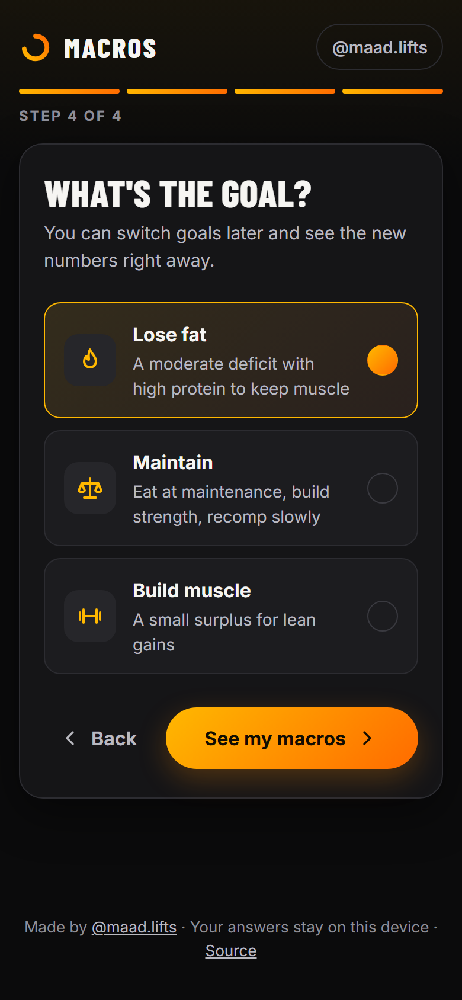

# Macro Calculator

Daily calories and protein, carb and fat targets in four short steps: about you, your body, how
active you are, and your goal (lose fat, maintain or build muscle).

**Live:** https://samaadturner.github.io/macro-calculator/

<p>
  
  
</p>

No sign-up and no server. Answers and saved plans stay in the browser's local storage, so a
returning visitor lands straight on their results.

## What it does

- Four steps, one group of questions per screen, with messages next to the field that needs fixing.
- Pounds and feet or kilograms and centimetres. Switching converts both weight and height, and
  switching back and forth never changes the numbers.
- Results: a ring of calories by macro, grams and share for each macro, a goal switcher that
  updates the numbers right away, grams per meal for 3 to 6 meals, and the working behind the
  numbers.
- Save up to ten plans on the device, copy a plan as text, or share it from a phone.

## How the numbers are worked out

1. **Resting energy (BMR)** with the Mifflin-St Jeor equation:
   `10 × kg + 6.25 × cm − 5 × age`, then `+5` for men and `−161` for women.
   "Other" uses the average of the two (`−78`).
2. **Maintenance** = BMR × activity factor (1.2 mostly sitting to 1.9 athlete).
3. **Goal:** lose fat = maintenance minus 20%, but never more than 500 calories;
   maintain = maintenance; build muscle = maintenance + 300.
4. **Calorie floor:** never below 1,200 (women), 1,500 (men) or 1,350 (other). When the floor
   applies, the results say so.
5. **Protein:** 2.2 g per kg when losing fat, 1.8 g per kg otherwise. Muscle gains level off at
   around 1.6 g/kg ([Morton et al. 2018](https://pubmed.ncbi.nlm.nih.gov/28698222/)), and a bit
   more helps keep muscle during a cut. Above a BMI of 25 the weight used is the weight at BMI 25
   for that height, because total weight overstates muscle at higher body fat. Capped at 40% of
   calories.
6. **Fat:** 25% of calories. **Carbs:** the rest, always at least about 35%.

Fat loss plans are not offered under 18. These are estimates: real energy needs can be a few
hundred calories away from any formula, which is why the results suggest checking your weight
trend after 2 to 3 weeks.

## Built with

React 18 and TypeScript on Vite. No UI or chart library: the ring is a small SVG component and
the styles are one CSS file of design tokens (colours, type, spacing) in
[`src/styles.css`](src/styles.css). Fonts (Inter and Barlow Condensed) are bundled, not loaded
from Google.

```
src/
  engine/       the math, no React: checks, unit conversion, the plan
  form.ts       form state, unit switching, which step is complete
  storage.ts    local storage, guarded against blocked or broken data
  components/   the steps, the results page and the ring
e2e/            Playwright tests, including axe accessibility scans
```

## Tests

- **52 unit tests** (Vitest) for the math, the checks, unit switching and storage. Every bug
  fixed in the old single-file version has a test, and one test runs 360 combinations of sex,
  goal, activity and extreme bodies to check no macro goes negative and the shares add to 100.
- **19 end-to-end tests** (Playwright) on a desktop and a phone screen (38 runs), against the
  production build. They cover the full flow in both unit systems, every error message, unit
  switching, the calorie floor, the under-18 rule, saved plans, returning visitors, broken saved
  data, keyboard use, no sideways scrolling, and an [axe](https://github.com/dequelabs/axe-core)
  scan for WCAG 2.1 A and AA rules on every step, with and without errors showing.

GitHub Actions runs lint, type checks, unit tests, the build and the end-to-end tests on every
push. The site is deployed to GitHub Pages from `main` only after all of them pass.

## Run it locally

Needs Node 20 or newer.

```bash
git clone https://github.com/SamaadTurner/macro-calculator.git
cd macro-calculator
npm install
npm run dev            # http://localhost:5173/macro-calculator/
```

| Command | What it does |
|---|---|
| `npm test` | Unit tests |
| `npx playwright install chromium` then `npm run e2e` | End-to-end tests (builds the site first) |
| `npm run lint` / `npm run typecheck` | ESLint / TypeScript |
| `npm run build` | Production build in `dist/` |

## Known limits

- Uses a formula only. It does not learn from your real weight changes yet.
- Dark theme only.
- `npm audit` reports moderate advisories in development-only packages (the Vite dev server and
  Vitest). None of that code is in the built site.

## Planned

A daily log of weight and calories, and an estimate of your real energy use from your weight
trend, so the targets adjust each week.

## License

MIT, see [LICENSE](LICENSE).
